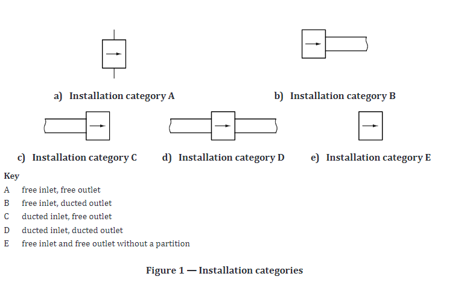
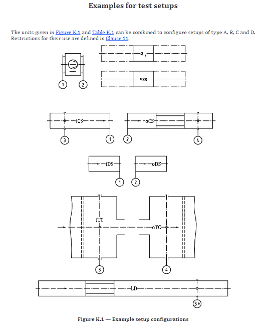
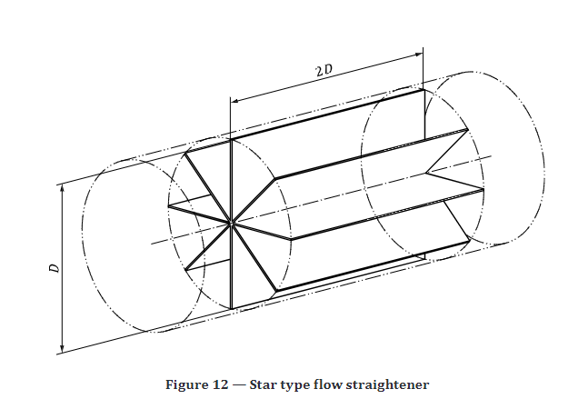
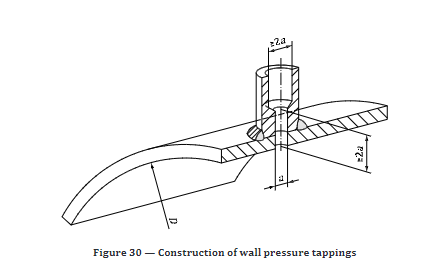
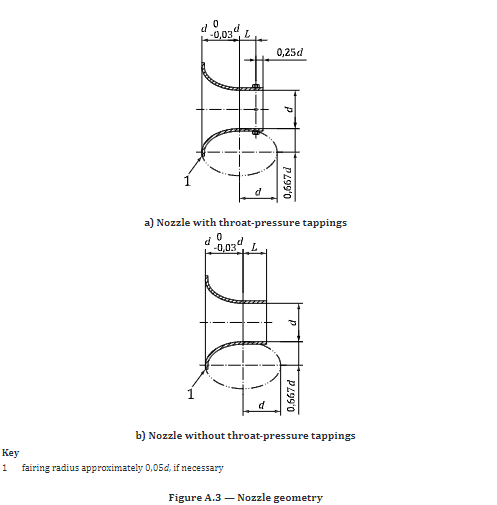
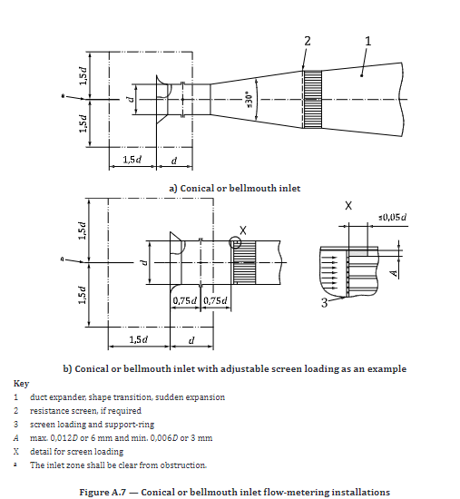
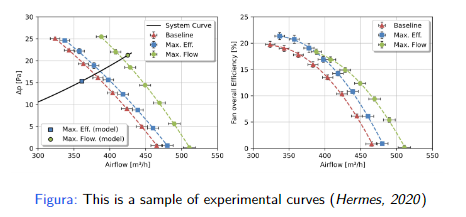

<!-- Logo de l'école ESEIAAT (UPC) -->

***

# **PC Fans for heating down the tower**
### *Advanced Fluid Dynamics Design*

 

<!-- Image du ventilateur d'ordinateur -->

 
 

### **Team members**

| Name| Role| Github username |
| :--- | :--- | :--- | 
| **Yoann Lunel** | Design / Leader | YoannLUNEL|
| **Erwann Penin** | CFD|ErwannPenin|
| **ANDRIANO GRANADOS MIGUEL ANGEL** | Experimentation |	MiguelAndriano|

 

---

**University :** ESEIAAT - Universitat Politècnica de Catalunya (UPC)  
**Course :** Advanced Fluid Dynamics Design         
**School year :** 2026 – 2027  
**Date :** [13/10/26]

## Team Organisation

Effective communication and structured workflow management are central to the success of our group project. To avoid misunderstandings and optimize project timelines, our team conducts a mandatory alignment meeting every Tuesday prior to our Advanced Fluid Dynamic Design course to review progress across all work packages. While every member individually completes the weekly course exercises to maintain a strong collective foundation, department leads (Design, CFD, and Experimental) take full ownership of their respective technical deliverables. During our weekly sessions, each lead presents their completed work, transparently outlines any technical hurdles or blocking points encountered, and shares the implemented solutions or proposed workarounds. To ensure continuous collaboration between scheduled meetings, a dedicated WhatsApp group enables immediate troubleshooting and real-time support. Furthermore, to streamline cross-departmental handoffs such as transferring CAD geometry to CFD simulations or experimental validation. All project assets, simulation datasets, and action items are maintained in a shared central repository with regular milestone tracking to guarantee full transparency and accountability.
A to do list has been created in order to follow each tasks and the evolution of the projects

## Introduction
A PC case fan plays a vital role in maintaining optimal operating temperatures by driving a continuous airflow throughout the chassis. The goal is to intake cool external air and exit the heat generated by high-performance components like the CPU and GPU to prevent thermal throttling and hardware damage. It is classified as an axial fan because its blades rotate around a central hub to draw air in and propel it forward in a parallel, linear direction along the rotation axis, making it highly effective at moving large volumes of air through the open space of a computer tower.

In order  to create a PC fans, a bibliographic work has been done. Three examples were taken to create our axial fan. The characteristics of these fans are listed in the table below. The formula Power = Pressure rise * Flow rate permits to calculate the pressure rise of each fans. The other informations was in the technical document of each fans. These documents are available on the websites below.

| Brand| Model| Flow rate |Pressure rise|Rotational speed|Size (mm)|link|
| :--- | :--- | :--- | :--- | :--- | :--- |:--- |
| **Corsair** | Ventilateur PWM 140 mm RS140 II ARGB | 0,04531 m³/s|119.2 Pa|2100 rpm|140x140x25|https://www.corsair.com/ww/fr/p/case-fans/co-9051073-ww/rs140-ii-argb-140mm-pwm-fan-co-9051073-ww|
| **Noctua** | CNF-A12x25 G2 PWM chromax.blackFD|0.02981 m³/s|60.4 Pa|1800 rpm|120x120x25|https://www.noctua.at/en/products/nf-a12x25-g2-pwm-chromax-black/specifications|
| **Artic** | P12 Pro LN |0.0231 m³/s|57.1 Pa|2000 rpm|120x120x25|https://www.arctic.de/en/P12-Pro-LN-5-Pack/ACFAN00349A#specs|

This documentation permits to define the characteristics of the PC fans of this projects.

## Technical specification of the projects 
- Rotational speed : 1800 rpm
- Pressure rise : 60 Pa
- Size (mm) : 120x120x25
- Flow rate : 0,0263889 m3/s
- Number of blades : 8
- Hub diameter (central hub): 50 mm
- Blade length (individual blade): 34.5 mm

## Repartition of team-work
Each of us specializes in a specific area (design, experiment, CFD), but we all share the required workload. For example, for D1 and D2, we all contributed to the notebook. Even though only the person in charge of the notebook usually pushes it to GitHub, this allows us to cross-check everyone's work, compare our results, and improve our code logic. It is also important for non-specialists to understand what the experts are doing, so they don't feel lost during classes or exams.

We discuss our results in our WhatsApp group or whenever we meet in person—there is no dedicated meeting time for this. This works well because we can ask questions and verify things right when we need to.

# Part 1 : Design 

## 1. Specifications and Dimensionless Parameters

The objective of this project is to design an axial cooling fan for a standard 120 mm PC case.

### 1.1 Design Specifications

The nominal operating point is calibrated with a benchmark of commercial fans (such as the Noctua NF-A12x25 operating at 1800 rpm, one of the three references).

| Parameter | Symbol | Value | Unit |
| :--- | :---: | :---: | :---: |
| Rotor Outer Diameter (Tip) | $D$ | 120.0 | mm |
| Hub Diameter | $D_h$ | 50.0 | mm |
| Number of Blades | $Z$ | 8 | // |
| Nominal Rotational Speed | $N$ ($\omega$) | 1800 - 188.50 | rpm - rad/s |
|  Flow Rate | $Q$ | 95 - 0.02638 | m³/h - m³/s |
| Target Total Pressure Rise | $\Delta P_0$ | 13.0 | Pa |
| Air Density at 20 °C | $\rho$ | 1.2 | kg/m³ |
| Air Dynamic Viscosity | $\mu$ | $1.8 \times 10^{-5}$ | Pa·s |

Total Pressure rise is found using the following formula  ($\Delta P_0 = \Delta P_{\text{stat}} + \frac{1}{2}\rho c_x^2$). Using the values of the Noctua, we found that for 95m³/h, $P_{stat}$=0.5mmH20 (4,9Pa) and $P_{dyn}$ = 8 Pa.

### 1.2 Mean-Radius Kinematic Analysis (RMS)

To accurately represent the average flow across the span while dividing the annulus into two equal-area regions between hub and tip, the preliminary analysis is performed at the **Root-Mean-Square (RMS) radius**:

$$
r_m = \sqrt{\frac{r_t^2 + r_h^2}{2}} = \sqrt{\frac{0.060^2 + 0.025^2}{2}} = 0.0460\text{ m} \quad (45.96\text{ mm})
$$

From the annular flow area $A = \pi (r_t^2 - r_h^2) = 9.346 \times 10^{-3}\text{ m}^2$ and Euler's turbomachinery equation (assuming purely axial inlet flow, $c_{\theta 1} = 0$, and ideal hydraulic efficiency $\eta = 1$ for preliminary sizing):

* **Blade tangential velocity:** $U = \omega \cdot r_m = \mathbf{8.66\text{ m/s}}$
* **Axial velocity:** $c_x = \frac{Q}{A} = \mathbf{2.82\text{ m/s}}$
* **Outlet tangential air velocity (swirl):** $c_{\theta 2} = \frac{\Delta P_0}{\rho \cdot U} = \mathbf{1.25\text{ m/s}}$

### 1.3 Dimensionless Parameters and Cordier Diagram

Dimensional analysis characterizes the aerodynamic similarity of the fan and validates the choice of an axial architecture:

* **Flow Coefficient ($\phi$):**
  $$\phi = \frac{Q}{\omega D^3} = \mathbf{0.0810}$$
   (Classical flow coefficient for a compact PC cooling fan)

* **Head (Pressure) Coefficient ($\psi$):**
  $$\psi = \frac{\Delta P_0}{\rho \omega^2 D^2} = \mathbf{0.0212}$$
   (Low aerodynamic loading typical of low-pressure axial fans)

* **Ideal Power Coefficient ($\hat{P}$):**
  $$\hat{P} = \phi \cdot \psi = \mathbf{0.001715}$$
  (Corresponds to an ideal aerodynamic power output of approximately $0.34\text{ W}$)

* **Machine Reynolds Number ($Re_D$):**
  $$Re_D = \frac{\rho c_x D}{\mu} = \mathbf{2.26 \times 10^4}$$
 (Low-Reynolds / transitional regime, meaning the blades are sensitive to laminar boundary layer separation)

* **Specific Diameter ($D_s$):**
  $$D_s = \frac{D (\Delta P_0 / \rho)^{1/4}}{Q^{1/2}} = \mathbf{1.3402}$$
  ( Falls directly within the optimal Cordier band for axial turbomachines)

* **Specific Speed ($\Omega_s$):**
  $$\Omega_s = \frac{\omega Q^{1/2}}{(\Delta P_0 / \rho)^{3/4}} = \mathbf{5.1279}$$
  (Since $\Omega_s > 2.5$, this confirms that an **axial fan** architecture is the optimal choice for these high-flow, low-pressure specifications.)

---

## 2. Geometric Description of the Axial Fan Components

The fan assembly consists of four main mechanical and aerodynamic sub-components designed to fit a standard $120 \times 120 \times 25\text{ mm}$ PC mounting envelope (105 mm mounting hole spacing with four $\varnothing 4.3\text{ mm}$ holes):

1. **Hub:** Central cylindrical core with an outer diameter of $D_h = 50\text{ mm}$ (hub-to-tip ratio $\nu = D_h / D = 0.417$). It houses the brushless DC motor (12 V), permanent magnets, and bearing assembly, while providing structural support for the blade roots.
2. **Impeller Blades:** A set of $Z = 8$ twisted airfoil blades extending from the hub ($r_h = 25\text{ mm}$) to the tip ($r_t = 60\text{ mm}$), so the blade span is equal to $h = 35\text{ mm}$. 
3. **Frame / Shroud:** Outer square housing ($120 \times 120\text{ mm}$) incorporating an internal cylindrical duct. A minimal **radial tip clearance** ($\approx 0.5\text{ to }1.0\text{ mm}$) is maintained between the blade tips and the shroud to prevent mechanical contact while minimizing tip leakage vortices.
4. **Support Struts:** Four thin stator struts connecting the rear motor mount to the outer frame. Their cross-section is streamlined to minimize wake drag and tonal noise from rotor–stator interaction.

---

## 3. Materials and Characteristics / Justification

Material selection is driven by three core requirements: **high stiffness under centrifugal loading** (to maintain tight tip clearances and prevent creep), **low rotational inertia**, and **vibration damping**. We choose materials used for the Noctua and the Corsair. 

| Component | Recommended Industrial Material | Technical Justification |
| :--- | :--- | :--- |
| **Impeller (Hub + Blades)** | **LCP-GF30** (Liquid Crystal Polymer) or **PBT-GF30**  | High Young's modulus minimizes radial elongation under centrifugal force and excellent dimensional stability and fatigue resistance. |
| **Frame (Shroud)** | **PBT / ABS-GF30** (30% glass-fiber reinforced)  | Optimal stiffness-to-cost ratio and good structural rigidity for case mounting. |
| **Bearings** | **Fluid Dynamic Bearing (FDB / SSO2)** or miniature ball bearings | Low friction, long service life ($> 150,000\text{ h}$ industrially), and quiet  at 1800 rpm. |

---

## 4. Mean-Line Analysis (2D Cascade Analysis)

The two-dimensional cascade analysis at the mean radius ($r_m = 45.96\text{ mm}$) follows the methodology established by Dixon & Hall and Lewis (1996), using relative velocities ($\mathbf{w}$) and relative flow angles ($\beta$) measured from the axial direction.

### 4.1 Relative Velocity Triangles

In the rotor's relative frame of reference ($w_{\theta 1} = U$ and $w_{\theta 2} = U - c_{\theta 2}$):

* **Relative inlet flow angle:** $\beta_1 = \arctan\left(\frac{U}{c_x}\right) = \mathbf{71.95^\circ}$ (relative velocity $w_1 = \sqrt{c_x^2 + U^2} = \mathbf{9.11\text{ m/s}}$)
* **Relative outlet flow angle:** $\beta_2 = \arctan\left(\frac{U - c_{\theta 2}}{c_x}\right) = \mathbf{69.15^\circ}$ (relative velocity $w_2 = \mathbf{7.93\text{ m/s}}$)
* **Nominal flow deflection:** $\epsilon^* = \beta_1 - \beta_2 = \mathbf{2.80^\circ}$
* **Mean relative flow angle:** $\beta_\infty = \arctan\left(\frac{\tan\beta_1 + \tan\beta_2}{2}\right) = \mathbf{70.66^\circ}$

### 4.2 Initial Sizing via the Diffusion Factor ($DF = 0.50$)

To prevent boundary layer separation on the suction side of the blades, Lieblein's Diffusion Factor is initially constrained to $DF = 0.50$:

$$
DF = \left(1 - \frac{\cos\beta_1}{\cos\beta_2}\right) + \frac{1}{2}\left(\frac{s}{l}\right)\cos\beta_1\big(\tan\beta_1 - \tan\beta_2\big)
$$

For $Z = 8$ blades, the circumferential pitch at the mean radius is $s = \frac{2\pi r_m}{Z} = \mathbf{36.10\text{ mm}}$. Assuming a typical profile drag coefficient $C_D = 0.02$, the initial cascade yields:

* **Maximum pitch-to-chord ratio:** $s/l = \mathbf{5.400}$ (solidity $\sigma = l/s = 0.185$)
* **Minimum chord length:** $l_{\min} = \mathbf{10.7\text{ mm}}$
* **Ideal lift coefficient ($C_D = 0$):** $C_{L,0} = 2\left(\frac{s}{l}\right)\cos\beta_\infty(\tan\beta_1 - \tan\beta_2) = \mathbf{1.585}$
* **Actual lift coefficient ($C_D = 0.02$):** $C_L = C_{L,0} - C_D\tan\beta_\infty = \mathbf{1.528}$

Although $DF = 0.50$ satisfies the diffusion limit, the resulting lift coefficient ($C_L = 1.528$) is too high (deviate too much the airflow) compared to the recommended limit ($C_L \le 1.0$). With low Reynolds numbers it can cause stall and severe efficiency drops.

### 4.3 Solidity Optimization for $C_L = 1$ and Blade Geometry (Howell's Rule)

To bring the lift coefficient down to **$C_L = 1$**, the pitch-to-chord ratio $s/l$ is reduced (increasing the chord length $l$ and solidity $\sigma$) by inverting the lift equation:

$$
\left(\frac{s}{l}\right)_{\text{opt}} = \frac{C_{L,\text{target}} + C_D \tan\beta_\infty}{2 \cos\beta_\infty (\tan\beta_1 - \tan\beta_2)} = \mathbf{3.601} \quad (\sigma = 0.278)
$$

Using **Howell's correlation** for a circular-arc camber line ($a/l = 0.5$, rotor exponent $n = 0.5$) and assuming zero incidence ($i = 0^\circ \implies \beta'_1 = \beta_1$), the camber angle ($\theta$), nominal deviation ($\delta^{\ast}$), blade angles ($\beta'_1$ and $\beta'_2$), and stagger angle ($\xi$) are computed as:

$$
m = 0.23\left(\frac{2a}{l}\right)^2 + \frac{\beta_2}{500} = 0.3683 \quad ; \quad \theta = \frac{\epsilon^{\ast}}{1 - m(s/l)^n} \quad ; \quad \delta^{\ast} = m\theta\left(\frac{s}{l}\right)^n
$$

The table below compares the initial cascade ($DF = 0.50$) and the optimized design ($C_L = 1.00$) for **$Z = 8$ blades**:

| Cascade Parameter | Initial ($DF = 0.50$, $Z = 8$) | Optimized ($C_L = 1.00$, $Z = 8$) |
| :--- | :---: | :---: |
| Pitch-to-chord ratio ($s/l$) | 5.400 | **3.603** |
| Solidity ($\sigma = l/s$) | 0.185 | **0.278** |
| Circumferential pitch ($s$) | 36.10 mm | **36.10 mm** |
| Chord length ($l$) | 10.70 mm | **10.03 mm** |
| Diffusion Factor ($DF$) | 0.500 | **0.3765** |
| Lift coefficient ($C_L$, $C_D = 0.02$) | 1.528 | **1.000** |
| Camber angle ($\theta$) | 19.42° | **9.29°** |
| Deviation angle ($\delta^*$) | 16.63° | **6.50°** |
| Blade inlet angle ($\beta'_1$) | 71.95° | **71.95°** |
| Blade outlet angle ($\beta'_2 = \beta_2 - \delta^*$) | 52.53° | **62.66°** |
| Stagger angle ($\xi = \frac{\beta'_1 + \beta'_2}{2}$) | 62.24° | **73.81°** |

Optimizing the chord to $l = 10.03\text{ mm}$ lowers the Diffusion Factor to **$DF = 0.3765$**/providing a wide safety margin against flow separation/and reduces the required camber to **$9.29^\circ$**. We use theses values to design our impellers (CAD) and for our simulation (CFD).

# Part 2 : CFD Analysis

## 1. Introduction

Optimizing the aerodynamic performance of a PC fan requires carefully balancing key fluid dynamic parameters—primarily maximizing volumetric airflow and static pressure rise while minimizing flow separation and turbulence. Relying solely on physical prototyping to achieve these aerodynamic targets is both costly and time-consuming. Therefore, integrating Computer-Aided Design (CAD) with Computational Fluid Dynamics (CFD) is essential to the engineering workflow. 

By utilizing cloud-based platforms such as Onshape and SimScale, this iterative process becomes highly agile. Onshape enables precise 3D modeling and rapid parametric adjustments of complex blade geometries, while SimScale provides immediate cloud-based CFD simulations to analyze velocity fields, pressure distributions, and aerodynamic efficiency prior to manufacturing. This workflow significantly reduces prototyping costs, prevents material waste, and yields a faster, more reliable, and aerodynamically optimized design.

---

## 2. 2D Cascade Analysis

### 2.1 Design Targets

While the airflow inside a turbomachine is inherently three-dimensional, unsteady, and complex, it can be effectively simplified during the preliminary design stages by modeling it as a steady, two-dimensional blade cascade. Based on the preliminary mean-line sizing calculations, the objective of this section is to numerically evaluate the aerodynamic performance and efficiency of the axial fan blade section using the following target parameters:

| Parameter | Symbol | Target Value |
| :--- | :---: | :---: |
| Blade span (extrusion length) | $z$ | $35\text{ mm}$ |
| Lift coefficient | $C_L$ | $1.0$ |
| Static pressure rise | $\Delta P_s$ | $4.9\text{ Pa}$ |
| Camber angle | $\theta$ | $9.2925^\circ$ |
| Deviation angle | $\delta$ | $6.4944^\circ$ |
| Chord length | $l$ | $10.03\text{ mm}$ |
| Stagger angle | $\xi$ | $73.8111^\circ$ |
| Diffusion factor | $DF$ | $0.3765$ |
| Pitch-to-chord ratio | $s/l$ | $3.6$ |

---

### 2.2 CAD Modeling

A 4-digit NACA airfoil profile was selected for the axial fan blade due to its balance of geometric simplicity, aerodynamic robustness, and numerical stability. Because these profiles are defined by exact, smooth analytical polynomials rather than discrete tabulated points, they eliminate surface curvature discontinuities in CAD and prevent artificial pressure spikes or premature flow separation in the boundary-layer mesh. Aerodynamically, their relatively generous leading-edge radius provides high tolerance to incidence variations across off-design operating points, while their predictable behavior at low Reynolds numbers mitigates severe laminar separation bubbles. Furthermore, since classical 1D/2D turbomachinery cascade correlations were calibrated on standard airfoil families, using a 4-digit NACA profile enables direct benchmarking between preliminary analytical calculations and CFD results.

A 4-digit NACA airfoil is designated as **NACA MPXX**, where:
- **$M$**: Maximum camber in percentage of the chord length.
- **$P$**: Position of the maximum camber in tenths of the chord length.
- **$XX$**: Maximum thickness in percentage of the chord length.

From the target camber angle ($\theta = 9.2925^\circ$), the maximum camber $f_{\max}$ and first digit $M$ are calculated as:

$$
f_{\max} = \frac{l}{2} \tan\left(\frac{\theta}{4}\right)
$$

$$
M = 100 \cdot \frac{f_{\max}}{l} = 50 \tan\left(\frac{9.2925^\circ}{4}\right) \approx 2.03 \implies M = 2
$$

To remain fully consistent with the assumptions of the 2D cascade analytical model, the second digit is set to **$P = 5$**, placing the maximum camber at $50\%$ of the chord length. Both the camber angle $\theta$ and Howell's deviation correlation assume a circular-arc camber line ($a/l = 0.5$), whose geometric apex naturally lies at mid-chord.

The last two digits are set to **$XX = 12$**, corresponding to a maximum thickness-to-chord ratio of $12\%$ ($t_{\max}/l = 0.12$). Given the short chord length at the mean radius ($l = 10.03\text{ mm}$), a $12\%$ thickness yields a physical thickness of approximately $1.20\text{ mm}$, ensuring sufficient structural rigidity against aerodynamic and centrifugal loads while remaining practical to manufacture. This results in the **NACA 2512** profile.

The airfoil coordinates were generated using [Airfoil Tools (NACA 4-Digit Generator)](http://airfoiltools.com/airfoil/naca4digit) and exported as a CSV file. Before importing into Onshape, a third column containing zero values ($z = 0$) must be added to the CSV file so that Onshape's *3D Fit Spline* / routing curve tool can properly parse the 3D point cloud. Once imported (in millimeters), the profile was scaled uniformly by a factor of **$10.03$** to match the target chord length ($l = 10.03\text{ mm}$), filled into a planar surface, and extruded (thickened) to a span of **$z = 0.035\text{ m}$ ($35\text{ mm}$)**, as shown below.

| Scaling the NACA 2512 Profile ($l = 10.03\text{ mm}$) | Extruding the Blade Span ($z = 35\text{ mm}$) |
| :---: | :---: |
|  |  |

Finally, the CAD geometry was imported into SimScale and rotated around the spanwise $z$-axis to apply the required stagger angle ($\xi = 73.8111^\circ$).

---

### 2.3 CFD Setup and Simulation

#### 2.3.1 Computational Domain and Meshing

Generating a high-quality computational mesh is foundational to achieving accurate, stable, and reliable CFD results, as spatial discretization governs how accurately the Navier-Stokes equations are resolved. Proper refinement in high-gradient regions—such as boundary layers, leading and trailing edges, and downstream wakes—is essential to capture wall shear stresses, pressure distributions, and potential flow separation without excessive numerical diffusion.

For this 2D cascade simulation, SimScale's **Hex-dominant Parametric** meshing algorithm was selected because it provides granular control over local discretization while minimizing numerical diffusion through flow-aligned hexahedral cells:

1. **Background Mesh Box & Domain Dimensions:** 
   A background mesh box was defined with bounding coordinates from $\min(-0.3, -0.018, 0)\text{ m}$ to $\max(0.9, 0.018, 0.035)\text{ m}$ and a base cell resolution of $(100, 3, 3)$ to maintain near-cubic cells.
   - **Pitchwise ($y$-direction):** Bounded between $-s/2$ and $+s/2$ ($\pm 0.018\text{ m}$, matching $s = 3.6 \times l \approx 0.036\text{ m}$) around the centered airfoil. Applying translational periodic boundary conditions to the upper and lower faces replicates the aerodynamic interference of an infinite cascade without meshing the full rotor.
   - **Streamwise ($x$-direction):** Extended far upstream and downstream of the blade so that the inflow remains uniform and undisturbed by the airfoil's upstream potential field, while allowing full wake dissipation and pressure recovery before the outlet.
   - **Spanwise ($z$-direction):** Constrained directly to the two spanwise faces of the extruded section ($0$ to $0.035\text{ m}$) with symmetry boundary conditions to enforce a strictly two-dimensional flow regime free of 3D tip-vortex or end-wall effects.

2. **Local Refinements:** 
   A **Level 5** surface and region refinement was applied around the airfoil and its immediate wake to resolve steep velocity and pressure gradients near the leading and trailing edges while keeping the far-field mesh coarse.

3. **Boundary Layer Inflation & $y^+$ Calculation:**
   To capture boundary-layer dynamics while optimizing computational cost via standard wall functions, the first cell center must lie within the logarithmic region ($y^+ \ge 30$).

The dimensionless wall distance $y^+$ is defined as:

$$
y^+ = \frac{y \, u_\tau}{\nu} \tag{1}
$$

where $y$ is the normal distance from the wall to the first cell center, $\nu = 1.529 \times 10^{-5}\text{ m}^2/\text{s}$ is the kinematic viscosity of air, and $u_\tau$ is the friction velocity:

$$
u_\tau = \sqrt{\frac{\tau_w}{\rho}} \tag{2}
$$

With air density $\rho = 1.196\text{ kg/m}^3$, relative inlet velocity $W_1 = 9.11\text{ m/s}$, and chord length $c \approx 0.01\text{ m}$, the chord-based Reynolds number is:

$$
\text{Re}_c = \frac{W_1 \, c}{\nu} = \frac{9.11 \times 0.01}{1.529 \times 10^{-5}} \approx 5\,958
$$

Using the flat-plate turbulent boundary-layer correlation for the skin friction coefficient $C_f$:

$$
C_f = \frac{0.058}{\text{Re}_c^{0.2}} = \frac{0.058}{(5958)^{0.2}} \approx 0.0102
$$

The wall shear stress $\tau_w$ and friction velocity $u_\tau$ are:

$$
\tau_w = \frac{1}{2} \rho W_1^2 C_f = 0.5 \times 1.196 \times (9.11)^2 \times 0.0102 \approx 0.506\text{ Pa}
$$

$$
u_\tau = \sqrt{\frac{0.506}{1.196}} \approx 0.650\text{ m/s}
$$

Rearranging Equation (1) for $y^+ \gt 30$:

$$
y = \frac{y^+ \, \nu}{u_\tau} \gt \frac{30 \times 1.529 \times 10^{-5}}{0.650} \approx 7.05 \times 10^{-4}\text{ m}
$$

Since $y$ represents the distance to the **center** of the first cell, the total height of the first boundary-layer cell ($\Delta y = 2y$) must satisfy $\Delta y \gt 1.41 \times 10^{-3}\text{ m}$ ($1.41\text{ mm}$). The boundary-layer inflation in SimScale was therefore configured with:
- **Number of layers:** $2$
- **Expansion ratio:** $1.2$
- **Minimum first layer thickness ($\Delta y$):** $1.5 \times 10^{-3}\text{ m}$ ($1.5\text{ mm}$)
- **Final layer thickness:** $0.5$ (relative)

This yields an actual dimensionless wall distance of:

$$
y^+ = \frac{(\Delta y / 2) \, u_\tau}{\nu} = \frac{0.75 \times 10^{-3} \times 0.650}{1.529 \times 10^{-5}} \approx 31.9 \gt 30
$$

confirming that the first cell center lies just inside the log-law region.

| Global Domain Mesh | Local Airfoil and Boundary Layer Mesh |
| :---: | :---: |
|  |  |

---

#### 2.3.2 Boundary Conditions

To simulate steady, incompressible airflow through the 2D blade cascade, the following boundary conditions were applied:
- **Velocity Inlet ($x_{\min}$):** Fixed uniform relative velocity vector $\vec{W}_1 = (2.82,\; 8.66,\; 0)\text{ m/s}$, corresponding to a magnitude of $W_1 = \sqrt{2.82^2 + 8.66^2} = 9.11\text{ m/s}$ and an inlet flow angle $\beta_1 = \arctan(8.66 / 2.82) = 71.96^\circ$.
- **Pressure Outlet ($x_{\max}$):** Fixed static gauge pressure of $P_{\text{out}} = 4.9\text{ Pa}$.
- **Periodic Faces ($y_{\min}, y_{\max}$):** Translational periodic boundary conditions matching the blade pitch ($s = 0.036\text{ m}$).
- **Lateral Faces ($z_{\min}, z_{\max}$):** Symmetry boundary conditions to enforce 2D flow behavior.
- **Airfoil Surface:** No-slip wall boundary condition with standard wall functions.

---

#### 2.3.3 Flow Field Analysis

The velocity magnitude contour illustrates the flow deflection and acceleration around the NACA 2512 airfoil. A distinct high-velocity region (in red/orange, peaking at $11.08\text{ m/s}$) develops over the suction side just downstream of the leading edge, indicating the local static pressure drop responsible for lift generation. Conversely, the flow decelerates sharply at the leading-edge stagnation point and within the boundary layer along the airfoil wall (in blue). Downstream of the trailing edge, a well-defined wake (in green/yellow) exhibits a clear momentum deficit, while the parallel oblique bands confirm the periodicity across adjacent blade passages.

**Physical Consistency:**
- **Flow Turning:** The downstream wake visibly deflects upward compared to the incoming flow angle, confirming that the blade successfully imparts angular momentum to the fluid.
- **Pressure–Suction Asymmetry:** Strong acceleration along the upper (suction) surface contrasted with lower velocities along the lower (pressure) surface confirms positive aerodynamic loading.
- **Boundary Layer & Periodicity:** Smooth boundary-layer attachment without massive stall and seamless continuity of the periodic wakes validate both the angle of attack and the numerical setup.

By extracting the area-averaged streamwise ($W_{2,x}$) and pitchwise ($W_{2,y}$) velocity components downstream of the trailing edge, the outlet relative flow angle $\beta_2$ is computed as:

$$
\beta_2 = \arctan\left(\frac{W_{2,y}}{W_{2,x}}\right)
$$

---

#### 2.3.4 Results and Discussion

| Parameter | Analytical Theory ($C_L = 1.0$) | CFD Simulation | Deviation |
| :--- | :---: | :---: | :---: |
| **Inlet relative angle ($\beta_1$)** | $71.96^\circ$ | $71.96^\circ$ | $0.00^\circ$ |
| **Outlet relative angle ($\beta_2$)** | $69.16^\circ$ | $70.03^\circ$ | $+0.87^\circ$ |
| **Flow deflection ($\epsilon = \beta_1 - \beta_2$)** | $2.80^\circ$ | $1.93^\circ$ | $-0.87^\circ$ |
| **Inlet relative velocity ($W_1$)** | $9.11\text{ m/s}$ | $9.11\text{ m/s}$ | $0.00\text{ m/s}$ |
| **Outlet relative velocity ($W_2$)** | $7.93\text{ m/s}$ | $8.26\text{ m/s}$ | $+0.33\text{ m/s}$ |
| **Lift coefficient ($C_L$)** | $1.000$ | $0.536$ | $-46.4\%$ |
| **Drag coefficient ($C_D$)** | $0.0200$ | $0.0746$ | $+273\%$ |
| **Diffusion factor ($DF$)** | $0.3765$ | $0.2510$ | $-33.3\%$ |
| **Static pressure rise ($\Delta p$)** | $10.83\text{ Pa}$ | $6.03\text{ Pa}$ | $-44.3\%$ |
| **Hydraulic efficiency ($\eta_h$)** | $100\%$ *(ideal assumption)* | $59.3\%$ | $-40.7\%$ |

The discrepancies between the analytical predictions and the CFD results are primarily driven by **low Reynolds number viscous effects** ($\text{Re}_c \approx 6\,000$) and the limitations of classical empirical cascade correlations:

1. **Boundary-Layer Thickening and Increased Drag:** Howell's deviation rule and the preliminary drag estimate ($C_D \approx 0.02$) were derived from wind-tunnel cascade tests operating at much higher Reynolds numbers ($\text{Re}_c \gt 10^5$), where boundary layers remain thin and energized. At $\text{Re}_c \approx 6\,000$, viscous forces dominate, significantly thickening the suction-side boundary layer and sharply increasing skin friction and form drag ($C_D = 0.0746$ vs. $0.0200$).
2. **Reduced Effective Camber and Flow Turning:** This viscous thickening alters the effective aerodynamic camber of the airfoil and increases the outlet deviation angle ($\delta$), reducing the actual flow deflection ($\beta_2 = 70.03^\circ$ instead of $69.16^\circ$, giving $\epsilon = 1.93^\circ$).
3. **Drop in Lift and Pressure Rise:** Because Euler's turbomachinery equation directly links pressure rise to the change in tangential velocity ($\Delta c_\theta$), the reduced flow turning leads to a proportional drop in lift coefficient ($C_L = 0.536$), diffusion factor ($DF = 0.251$), and actual static pressure rise ($\Delta p = 6.03\text{ Pa}$ vs. $10.83\text{ Pa}$).
4. **Numerical Modeling Consideration:** Additionally, at $\text{Re}_c \approx 6\,000$, the boundary layer is largely transitional or laminar rather than fully turbulent. Using a high-$y^+$ wall-function mesh ($y^+ \approx 31.9$, where the first cell height of $1.5\text{ mm}$ represents $15\%$ of the $10\text{ mm}$ chord) introduces extra numerical dissipation near the wall. In future iterations, resolving the viscous sublayer directly ($y^+ \lt 1$) with a low-Reynolds turbulence model (such as $k\text{-}\omega\text{ SST}$) would capture the near-wall velocity profile with even greater fidelity.

## References & Acknowledgments

### Literature & Course Materials
* **Dixon, S. L., & Hall, C. A.** (2010). *Fluid Mechanics and Thermodynamics of Turbomachinery* (6th ed.). Oxford: Butterworth-Heinemann / Elsevier. ISBN: 978-1856177931.
* **Castilla López, R.** *Advanced Fluid Dynamic Design* — Lecture notes and course repository on GitHub (Universitat Politècnica de Catalunya - UPC).

### Software, Tools & Tutorials
* **Airfoil Tools.** *NACA 4-Digit Airfoil Generator (NACA 2512)*. Available at: [http://airfoiltools.com/airfoil/naca4digit](http://airfoiltools.com/airfoil/naca4digit?MNaca4DigitForm%5Bcamber%5D=2&MNaca4DigitForm%5Bposition%5D=50&MNaca4DigitForm%5Bthick%5D=12&MNaca4DigitForm%5BnumPoints%5D=200&MNaca4DigitForm%5BcosSpace%5D=0&MNaca4DigitForm%5BcosSpace%5D=1&MNaca4DigitForm%5BcloseTe%5D=0&yt0=Plot).
* **SimScale.** *2D Airfoil & Turbomachinery Cascade CFD Simulation Tutorials and Documentation*. Available at: [https://www.simscale.com/docs/](https://www.simscale.com/docs/).

### AI Assistance Disclosure
* Generative AI tools were used to format LaTeX mathematical equations and refine the English academic phrasing of this report. All engineering calculations, CAD geometries, CFD setups, and physical analyses were independently performed and verified by the author.

# Part 3 : Experimental Work Package & Test Bench Specification

## 3.1. <u>Objectives & Relevant Variables of the Axial Fan</u>

### 3.1.1 Experimental Scope & Validation Role

The primary objective of the experimental work package is to design, instrument, and operate a standardized aerodynamic test bench to characterize our 120 mm axial PC cooling fan. Physical testing serves as the empirical ground truth needed to validate the 1D mean-line aerodynamic calculations and the 3D Reynolds-Averaged Navier-Stokes (RANS) CFD simulations across the complete operational envelope.

### 3.1.2 Target Fan Specifications & Operational Domain

Based on the design targets established in Release 0, our physical test rig must evaluate a compact 120 mm axial fan operating under the following nominal parameters:

- **Impeller Outer Diameter (*D*):** 120 mm (0.12 m)
- **Hub Diameter (*D*hub):** 50 mm (Hub-to-tip ratio ν = 0.417)
- **Design Rotational Speed (*N*):** 1800 rpm (ω = 188.5 rad/s)
- **Design Static Pressure Rise (Δ*p*s):** 60 Pa
- **Design Volumetric Airflow (*q*V):** 0.02639 m³/s (95.0 m³/h or 55.9 CFM)

### 3.1.3 Relevant Aerodynamic & Dimensionless Variables

To evaluate fan performance independently of ambient atmospheric variations, raw sensor measurements are reduced to standardized dimensional and dimensionless parameters:

| Variable | Symbol | Definition / Formula | Units | Physical Significance |
| :--- | :---: | :---: | :---: | :--- |
| **Volumetric Airflow** | *q*V | *q*V = ∫ *v*z d*A* | m³/s | Cooling air delivery capacity |
| **Static Pressure Rise** | Δ*p*s | Δ*p*s = *p*s4 − *p*a | Pa | Head available to overcome system impedance |
| **Dynamic Pressure** | *p*d2 | *p*d2 = ½ ρa (*q*V / *A*fan)² | Pa | Kinetic energy of the discharge jet |
| **Fan Total Pressure** | Δ*p*t | Δ*p*t = Δ*p*s + *p*d2 | Pa | Total mechanical energy imparted to fluid |
| **Air Aerodynamic Power** | *P*u | *P*u = *q*V · Δ*p*t | W | Useful fluid output power |
| **Shaft Input Power** | *P*a | *P*a = ω · τ | W | Mechanical power supplied to the rotor shaft |
| **Total-to-Total Efficiency** | ηt | ηt = *P*u / *P*a | − | Overall energy conversion efficiency |
| **Flow Coefficient** | Φ | Φ = *q*V / ((π/4) *D*² · *u*tip) | − | Non-dimensional axial velocity ratio |
| **Pressure Coefficient** | Ψ | Ψ = Δ*p*t / (½ ρa *u*tip²) | − | Non-dimensional pressure loading capacity |

---

## 3.2. <u>ISO 5801:2019 Application & Test Bench Architecture</u>

### 3.2.1 Installation Category Selection

In accordance with **UNE-EN ISO 5801:2019 (Clause 5 & 6)**, fan installations are categorized into types A, B, C, and D based on duct connections. For our 120 mm cooling fan, we implement a **Category B setup (Free Inlet, Ducted Outlet)**. This configuration accurately replicates real-world PC tower operation, where the fan draws ambient air freely from the surroundings and discharges it through internal ducting or across heatsink fin arrays.

_Source Reference:_ UNE-EN ISO 5801:2019, Clause 5, Figure 1 (Page 14). _Figure Caption:_ Standardized fan installation categories defined in ISO 5801. Our test rig corresponds to Category B (unobstructed free intake at Plane 1 and a continuous discharge airway at Plane 2).

### 3.2.2 Standardized Airway Layout (LD & oCS)

The test rig consists of a cylindrical acrylic/PVC duct with an internal diameter matched to the fan outer casing (*D* = 120 mm). Downstream of the fan, an **Outlet Common Segment (oCS)** provides straight duct lengths to allow boundary layers to stabilize and eliminate flow distortion:

- **Distance to Flow Straightener:** Located 2*D* to 3*D* downstream of the fan exit.
- **Distance to Pressure Tapping Plane (Plane 4):** Located at least 4*D* downstream of the straightener.
- **Total Downstream Straight Length:** ≥ 6*D* (720 mm) ahead of flow rate metering.

%20layout%20and%20dimensions.png)

_Source Reference:_ UNE-EN ISO 5801:2019, Clause 8.6, Figure 6 (Page 23) and Annex K, Figure K.1 (Page 141). _Figure Caption:_ General assembly of the ISO 5801 Category B ducted test bench, detailing modular sections: fan mounting bracket, outlet segment (`oCS`), straightener plane, piezometer tapping station (Plane 4), and throttling gate.

### 3.2.3 Swirl Elimination via Flow Straightener

Axial impellers impart a significant tangential swirl velocity component (*v*θ) into the discharge jet. Under ISO 5801 Clause 10.3 and Annex G, **swirl kinetic energy must not be converted into or credited as static pressure rise**. To eliminate swirl before reaching the pressure sensors, a standardized **star-type straightener** (or a fine cell honeycomb straightener) is installed.

_Source Reference:_ UNE-EN ISO 5801:2019, Clause 10.3.3, Figure 12 (Page 32) and Annex G (Page 129). _Figure Caption:_ Standardized 8-bladed star straightener designed to suppress tangential vorticity and align streamlines strictly in the axial direction upstream of static pressure tappings.

### 3.2.4 Variable Supply System (VSS Throttle)

To map the fan's complete aerodynamic curve from **Free Delivery** (Δ*p* = 0) to **Stall / Shut-off** (*q*V = 0), an adjustable conical plug or iris throttle gate is placed at the duct outlet. Operating points are scanned across 8 to 10 stabilized positions, holding each state for at least 60 seconds to satisfy ISO 5801 steady-state averaging criteria.

---

## 3.3. <u>Proposed Instrumentation Chain & Data Acquisition</u>

  DATA ACQUISITION CHAIN

| Physical Variable  | Primary Transducer             | DAQ / Interface  |
| ------------------ | ------------------------------ | ---------------- |
| Static Pressure    | Keller PD-39X Transducer       | RS485 / Modbus   |
| Airflow Rate       | ISO 5167 Nozzle + Diff. Press. | Analog (0-10 V)  |
| Rotational Speed   | Optical Laser Tachometer       | Counter / Timer  |
| Power Input        | Precision Shunt + Hall Sensor  | 16-bit ADC Board |
| Ambient ($P_a, T$) | Digital Barometer + Pt100 RTD  | I2C / SPI Module |

### 3.3.1 Static Pressure Tappings & Piezometer Ring

Because compact PC cooling fans operate at low pressures (10 Pa to 150 Pa), pressure signals are highly sensitive to wall tap quality. In accordance with ISO 5801 Clause 12.8, static pressure at Plane 4 is captured using a **four-tap piezometer ring**:

- Four orifices are drilled at 90° circumferential intervals and joined by a balanced manifold ring to average out peripheral pressure asymmetries.
- Taps are precision-machined (*d* = 0.8 mm), strictly perpendicular to the inner duct surface, and completely deburred to prevent recirculating cavity eddies from artificially elevating measured static pressure (*P*SP > *P*s).

.png)

*Source Reference:* UNE-EN ISO 5801:2019, Clause 12.8, Figure 29 & 30 (Pages 49–50) and Course Slides `02-Pressure_Measurements.pdf` (Slides 22–27).  
*Figure Caption:* (Left) Toroidal piezometer ring connecting four orthogonal wall pressure taps. (Right) Correct orifice geometry (*L*/*d* ≥ 2, sharp, burr-free edge) vs. improper chamfered taps that induce measurement-biasing cavity vortices.

### 3.3.2 Airflow Rate Metering: Differential Pressure Constriction

Airflow is measured in-line using a standardized differential constriction device (ISO 5167 / ISO 5801 Annex A elliptical nozzle). By capturing the differential pressure drop (Δ*p*nozzle) between the upstream settling duct and the nozzle throat, mass and volume flow rates are calculated analytically via standard discharge coefficients (*C*d).

*Source Reference:* UNE-EN ISO 5801:2019, Annex A, Figure A.3 & A.7 (Pages 83 & 88).  
*Figure Caption:* Geometry of the ISO 5801 calibrated elliptical constriction nozzle, showing throat diameter ratio (β = *d*/*D*) and tap planes for differential pressure metering

### 3.3.3 Rotational Speed (*N*) & Calibrated Motor Shaft Power (*P*a)

Direct inline torque sensors cannot fit inside an integrated 120 mm PC fan hub. Instead, we implement the **calibrated motor method** (ISO 5801 Clause 12.4.3.4):

1. **Speed (*N*):** Measured using a non-contact optical tachometer counting laser reflections off a blade tip, cross-verified with the internal Hall-effect pulse pin.
2. **Electrical Input (*P*e):** Monitored via high-precision voltage and current sense circuitry (*P*e = *V* · *I*).
3. **Shaft Power (*P*a):** Derived by subtracting pre-calibrated motor copper losses and bearing friction losses from electrical input power (*P*a = *P*e · ηmotor − *P*loss).

---

## 3.4. <u>Bill of Materials & Selected Test Bench Components</u>

| Subsystem | Component Description | Manufacturer / Model | Selected Specifications |
| :--- | :--- | :--- | :--- |
| **Duct Airway** | Cylindrical transparent test duct | Custom Cast Acrylic | *D*in = 120 mm, Length = 1.2 m, Wall = 4 mm |
| **Straightener** | Star-type anti-swirl straightener | 3D Printed (PLA/PETG) | 8 radial blades, *L* = 2*D* = 240 mm, thickness 0.8 mm |
| **Pressure Sensor** | Ultra-low differential transmitter | **KELLER PD-39X** (or WIKA DPT) | Range: 0 – 250 Pa, Accuracy: ±0.1% FS, RS485 |
| **Flow Meter** | Calibrated elliptical nozzle | Precision CNC Aluminum | Throat *d* = 60 mm (β = 0.50), ISO 5167 profile |
| **Speed Sensor** | Digital optical tachometer | Monarch / Compact Laser | Range: 0 – 5000 rpm, Resolution: 1 rpm, ±0.05% |
| **Ambient Sensing** | Barometric & RTD sensor unit | Bosch BME280 / Pt100 | *p*a: 900 – 1100 hPa (±1 hPa), *T*: ±0.2 °C |
| **Throttle (VSS)** | Adjustable iris / conical baffle | Custom 3D Printed / Metallic | Stepper-actuated continuous throttling gate |
| **DAQ System** | Multi-channel data logger | National Instruments / LabJack | 16-bit analog differential inputs, USB/Ethernet |

---

## 3.5. <u>Data Reduction Pipeline & Uncertainty Analysis</u>

### 3.5.1 Analytical Data Reduction

From the raw environmental and physical readings, the data reduction algorithm executes the following sequence:

1. **Air Density (ρa):**

  

2. **Volumetric Airflow Rate (*q*V):**

  

3. **Fan Total Pressure Rise (Δ*p*t):**

  

4. **Overall Total Efficiency (ηt):**

  

   
### 3.5.2 Uncertainty Propagation (Root-Sum-Square)

In compliance with ISO 5801 Clause 17 and experimental error theory, uncertainties are propagated using first-order Taylor series expansions. For any derived quantity *F*(*x*1, *x*2, ..., *x*n):

  

For total fan efficiency (ηt), the relative combined standard uncertainty is:

  

All final experimental curves will be presented with **95% confidence error bars** (*U* = 2 · σF).

 

*Source Reference:* Typical fan rating curve per ISO 5801 Clause 16 / AMCA 210.  
*Figure Caption:* Expected output performance curves: Fan Total Pressure (Δ*p*t [Pa]) and Efficiency (ηt [%]) vs. Flow Rate (*q*V [m³/h]), featuring ±2σ error bars for validation against 1D design and CFD predictions.

