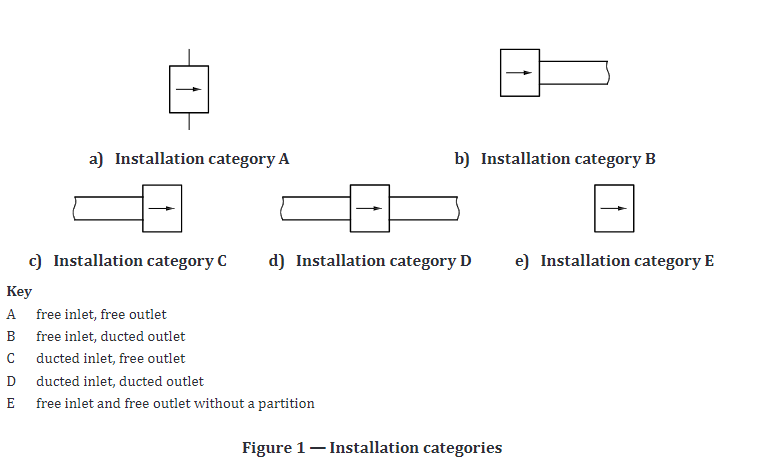
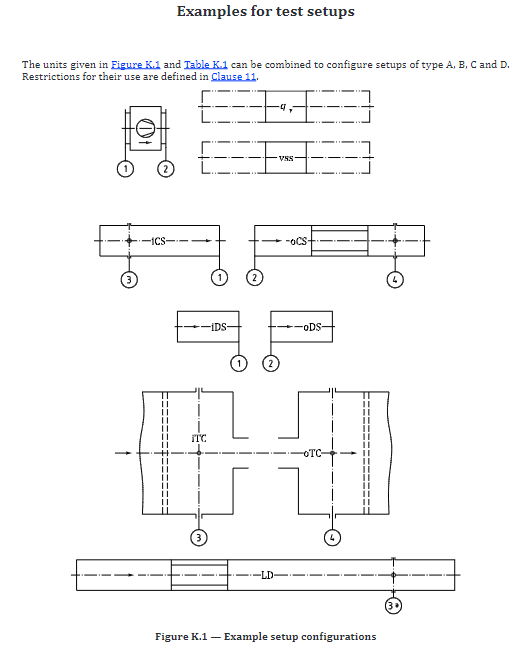
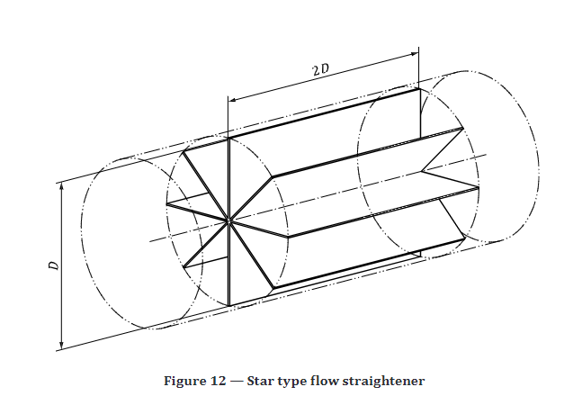
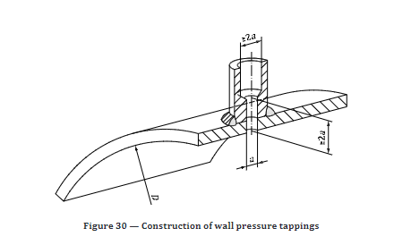
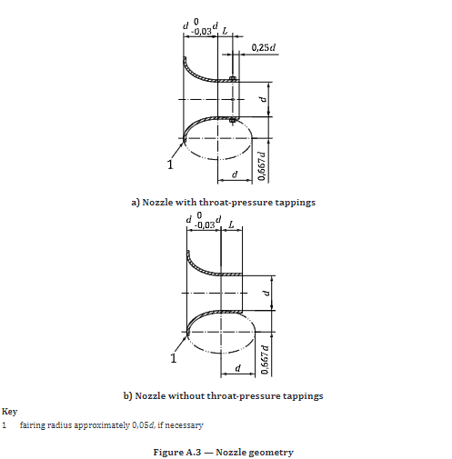
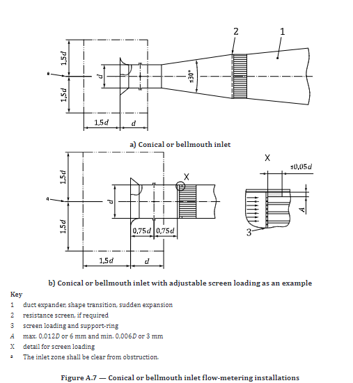
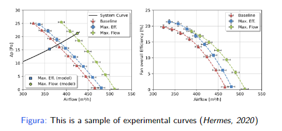

# III. Experimental Work Package & Test Bench Specification

## 3.1. <u>Objectives & Relevant Variables of the Axial Fan</u>

### 3.1.1 Experimental Scope & Validation Role

The primary objective of the experimental work package is to design, instrument, and operate a standardized aerodynamic test bench to characterize our 120 mm axial PC cooling fan. Physical testing serves as the empirical ground truth needed to validate the 1D mean-line aerodynamic calculations and the 3D Reynolds-Averaged Navier-Stokes (RANS) CFD simulations across the complete operational envelope.

### 3.1.2 Target Fan Specifications & Operational Domain

Based on the design targets established in Release 0, our physical test rig must evaluate a compact 120 mm axial fan operating under the following nominal parameters:

- **Impeller Outer Diameter (*D*):** 120 mm (0.12 m)
- **Hub Diameter (*D*hub):** 50 mm (Hub-to-tip ratio ν = 0.417)
- **Design Rotational Speed (*N*):** 1800 rpm (ω = 188.5 rad/s)
- **Design Static Pressure Rise (Δ*p*s):** 60 Pa
- **Design Volumetric Airflow (*q*V):** 0.02639 m³/s (95.0 m³/h or 55.9 CFM)

### 3.1.3 Relevant Aerodynamic & Dimensionless Variables

To evaluate fan performance independently of ambient atmospheric variations, raw sensor measurements are reduced to standardized dimensional and dimensionless parameters:

| Variable | Symbol | Definition / Formula | Units | Physical Significance |
| :--- | :---: | :---: | :---: | :--- |
| **Volumetric Airflow** | *q*V | *q*V = ∫ *v*z d*A* | m³/s | Cooling air delivery capacity |
| **Static Pressure Rise** | Δ*p*s | Δ*p*s = *p*s4 − *p*a | Pa | Head available to overcome system impedance |
| **Dynamic Pressure** | *p*d2 | *p*d2 = ½ ρa (*q*V / *A*fan)² | Pa | Kinetic energy of the discharge jet |
| **Fan Total Pressure** | Δ*p*t | Δ*p*t = Δ*p*s + *p*d2 | Pa | Total mechanical energy imparted to fluid |
| **Air Aerodynamic Power** | *P*u | *P*u = *q*V · Δ*p*t | W | Useful fluid output power |
| **Shaft Input Power** | *P*a | *P*a = ω · τ | W | Mechanical power supplied to the rotor shaft |
| **Total-to-Total Efficiency** | ηt | ηt = *P*u / *P*a | − | Overall energy conversion efficiency |
| **Flow Coefficient** | Φ | Φ = *q*V / ((π/4) *D*² · *u*tip) | − | Non-dimensional axial velocity ratio |
| **Pressure Coefficient** | Ψ | Ψ = Δ*p*t / (½ ρa *u*tip²) | − | Non-dimensional pressure loading capacity |

---

## 3.2. <u>ISO 5801:2019 Application & Test Bench Architecture</u>

### 3.2.1 Installation Category Selection

In accordance with **UNE-EN ISO 5801:2019 (Clause 5 & 6)**, fan installations are categorized into types A, B, C, and D based on duct connections. For our 120 mm cooling fan, we implement a **Category B setup (Free Inlet, Ducted Outlet)**. This configuration accurately replicates real-world PC tower operation, where the fan draws ambient air freely from the surroundings and discharges it through internal ducting or across heatsink fin arrays.

_Source Reference:_ UNE-EN ISO 5801:2019, Clause 5, Figure 1 (Page 14). _Figure Caption:_ Standardized fan installation categories defined in ISO 5801. Our test rig corresponds to Category B (unobstructed free intake at Plane 1 and a continuous discharge airway at Plane 2).

### 3.2.2 Standardized Airway Layout (LD & oCS)

The test rig consists of a cylindrical acrylic/PVC duct with an internal diameter matched to the fan outer casing (*D* = 120 mm). Downstream of the fan, an **Outlet Common Segment (oCS)** provides straight duct lengths to allow boundary layers to stabilize and eliminate flow distortion:

- **Distance to Flow Straightener:** Located 2*D* to 3*D* downstream of the fan exit.
- **Distance to Pressure Tapping Plane (Plane 4):** Located at least 4*D* downstream of the straightener.
- **Total Downstream Straight Length:** ≥ 6*D* (720 mm) ahead of flow rate metering.

%20layout%20and%20dimensions.png)

_Source Reference:_ UNE-EN ISO 5801:2019, Clause 8.6, Figure 6 (Page 23) and Annex K, Figure K.1 (Page 141). _Figure Caption:_ General assembly of the ISO 5801 Category B ducted test bench, detailing modular sections: fan mounting bracket, outlet segment (`oCS`), straightener plane, piezometer tapping station (Plane 4), and throttling gate.

### 3.2.3 Swirl Elimination via Flow Straightener

Axial impellers impart a significant tangential swirl velocity component (*v*θ) into the discharge jet. Under ISO 5801 Clause 10.3 and Annex G, **swirl kinetic energy must not be converted into or credited as static pressure rise**. To eliminate swirl before reaching the pressure sensors, a standardized **star-type straightener** (or a fine cell honeycomb straightener) is installed.

_Source Reference:_ UNE-EN ISO 5801:2019, Clause 10.3.3, Figure 12 (Page 32) and Annex G (Page 129). _Figure Caption:_ Standardized 8-bladed star straightener designed to suppress tangential vorticity and align streamlines strictly in the axial direction upstream of static pressure tappings.

### 3.2.4 Variable Supply System (VSS Throttle)

To map the fan's complete aerodynamic curve from **Free Delivery** (Δ*p* = 0) to **Stall / Shut-off** (*q*V = 0), an adjustable conical plug or iris throttle gate is placed at the duct outlet. Operating points are scanned across 8 to 10 stabilized positions, holding each state for at least 60 seconds to satisfy ISO 5801 steady-state averaging criteria.

---

## 3.3. <u>Proposed Instrumentation Chain & Data Acquisition</u>

  DATA ACQUISITION CHAIN

| Physical Variable  | Primary Transducer             | DAQ / Interface  |
| ------------------ | ------------------------------ | ---------------- |
| Static Pressure    | Keller PD-39X Transducer       | RS485 / Modbus   |
| Airflow Rate       | ISO 5167 Nozzle + Diff. Press. | Analog (0-10 V)  |
| Rotational Speed   | Optical Laser Tachometer       | Counter / Timer  |
| Power Input        | Precision Shunt + Hall Sensor  | 16-bit ADC Board |
| Ambient ($P_a, T$) | Digital Barometer + Pt100 RTD  | I2C / SPI Module |

### 3.3.1 Static Pressure Tappings & Piezometer Ring

Because compact PC cooling fans operate at low pressures (10 Pa to 150 Pa), pressure signals are highly sensitive to wall tap quality. In accordance with ISO 5801 Clause 12.8, static pressure at Plane 4 is captured using a **four-tap piezometer ring**:

- Four orifices are drilled at 90° circumferential intervals and joined by a balanced manifold ring to average out peripheral pressure asymmetries.
- Taps are precision-machined (*d* = 0.8 mm), strictly perpendicular to the inner duct surface, and completely deburred to prevent recirculating cavity eddies from artificially elevating measured static pressure (*P*SP > *P*s).

.png)

*Source Reference:* UNE-EN ISO 5801:2019, Clause 12.8, Figure 29 & 30 (Pages 49–50) and Course Slides `02-Pressure_Measurements.pdf` (Slides 22–27).  
*Figure Caption:* (Left) Toroidal piezometer ring connecting four orthogonal wall pressure taps. (Right) Correct orifice geometry (*L*/*d* ≥ 2, sharp, burr-free edge) vs. improper chamfered taps that induce measurement-biasing cavity vortices.

### 3.3.2 Airflow Rate Metering: Differential Pressure Constriction

Airflow is measured in-line using a standardized differential constriction device (ISO 5167 / ISO 5801 Annex A elliptical nozzle). By capturing the differential pressure drop (Δ*p*nozzle) between the upstream settling duct and the nozzle throat, mass and volume flow rates are calculated analytically via standard discharge coefficients (*C*d).

*Source Reference:* UNE-EN ISO 5801:2019, Annex A, Figure A.3 & A.7 (Pages 83 & 88).  
*Figure Caption:* Geometry of the ISO 5801 calibrated elliptical constriction nozzle, showing throat diameter ratio (β = *d*/*D*) and tap planes for differential pressure metering

### 3.3.3 Rotational Speed (*N*) & Calibrated Motor Shaft Power (*P*a)

Direct inline torque sensors cannot fit inside an integrated 120 mm PC fan hub. Instead, we implement the **calibrated motor method** (ISO 5801 Clause 12.4.3.4):

1. **Speed (*N*):** Measured using a non-contact optical tachometer counting laser reflections off a blade tip, cross-verified with the internal Hall-effect pulse pin.
2. **Electrical Input (*P*e):** Monitored via high-precision voltage and current sense circuitry (*P*e = *V* · *I*).
3. **Shaft Power (*P*a):** Derived by subtracting pre-calibrated motor copper losses and bearing friction losses from electrical input power (*P*a = *P*e · ηmotor − *P*loss).

---

## 3.4. <u>Bill of Materials & Selected Test Bench Components</u>

| Subsystem | Component Description | Manufacturer / Model | Selected Specifications |
| :--- | :--- | :--- | :--- |
| **Duct Airway** | Cylindrical transparent test duct | Custom Cast Acrylic | *D*in = 120 mm, Length = 1.2 m, Wall = 4 mm |
| **Straightener** | Star-type anti-swirl straightener | 3D Printed (PLA/PETG) | 8 radial blades, *L* = 2*D* = 240 mm, thickness 0.8 mm |
| **Pressure Sensor** | Ultra-low differential transmitter | **KELLER PD-39X** (or WIKA DPT) | Range: 0 – 250 Pa, Accuracy: ±0.1% FS, RS485 |
| **Flow Meter** | Calibrated elliptical nozzle | Precision CNC Aluminum | Throat *d* = 60 mm (β = 0.50), ISO 5167 profile |
| **Speed Sensor** | Digital optical tachometer | Monarch / Compact Laser | Range: 0 – 5000 rpm, Resolution: 1 rpm, ±0.05% |
| **Ambient Sensing** | Barometric & RTD sensor unit | Bosch BME280 / Pt100 | *p*a: 900 – 1100 hPa (±1 hPa), *T*: ±0.2 °C |
| **Throttle (VSS)** | Adjustable iris / conical baffle | Custom 3D Printed / Metallic | Stepper-actuated continuous throttling gate |
| **DAQ System** | Multi-channel data logger | National Instruments / LabJack | 16-bit analog differential inputs, USB/Ethernet |

---

## 3.5. <u>Data Reduction Pipeline & Uncertainty Analysis</u>

### 3.5.1 Analytical Data Reduction

From the raw environmental and physical readings, the data reduction algorithm executes the following sequence:

1. **Air Density (ρa):**

  

2. **Volumetric Airflow Rate (*q*V):**

  

3. **Fan Total Pressure Rise (Δ*p*t):**

  

4. **Overall Total Efficiency (ηt):**

  

   
### 3.5.2 Uncertainty Propagation (Root-Sum-Square)

In compliance with ISO 5801 Clause 17 and experimental error theory, uncertainties are propagated using first-order Taylor series expansions. For any derived quantity *F*(*x*1, *x*2, ..., *x*n):

  

For total fan efficiency (ηt), the relative combined standard uncertainty is:

  

All final experimental curves will be presented with **95% confidence error bars** (*U* = 2 · σF).

 

*Source Reference:* Typical fan rating curve per ISO 5801 Clause 16 / AMCA 210.  
*Figure Caption:* Expected output performance curves: Fan Total Pressure (Δ*p*t [Pa]) and Efficiency (ηt [%]) vs. Flow Rate (*q*V [m³/h]), featuring ±2σ error bars for validation against 1D design and CFD predictions.

